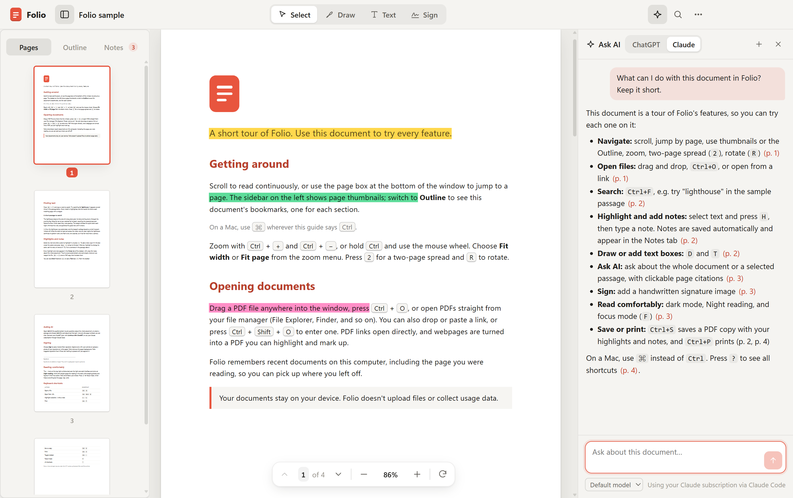
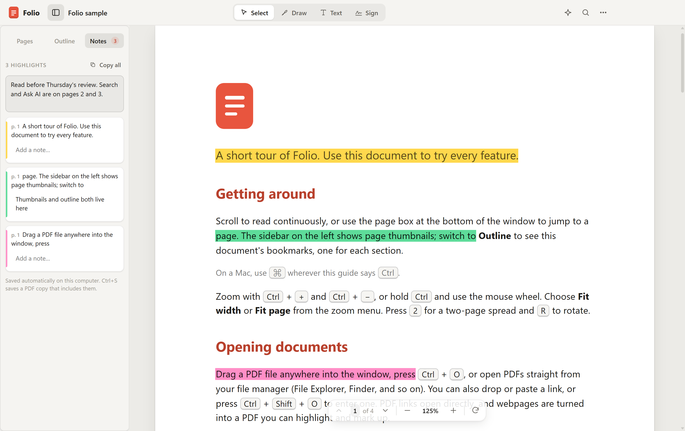
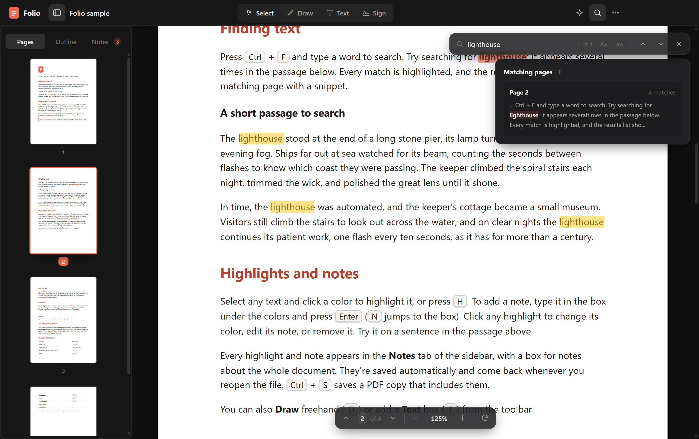

# Folio

A fast, clean PDF reader for Windows, macOS, and Linux. Read, highlight, annotate, sign, and ask AI about your
documents. Free and open source, with no Folio account required.



| Highlights and notes | Search |
| --- | --- |
|  |  |

## Download

| Platform | Download | Updates |
| --- | --- | --- |
| **Windows** 10/11 (64-bit) | [Folio-Setup.exe](https://github.com/Forward-Future/folio-releases/releases/latest/download/Folio-Setup.exe) | Automatic |
| **macOS** 12 or later (Apple Silicon and Intel) | [Folio-mac.dmg](https://github.com/Forward-Future/folio-releases/releases/latest/download/Folio-mac.dmg) | Folio tells you when a new version is out |
| **Linux**: Ubuntu, Debian, and derivatives (64-bit) | [Folio-linux-amd64.deb](https://github.com/Forward-Future/folio-releases/releases/latest/download/Folio-linux-amd64.deb) | Automatic, with your system updates (apt) |
| **Linux**: other distributions (64-bit) | [Folio-linux-x86_64.AppImage](https://github.com/Forward-Future/folio-releases/releases/latest/download/Folio-linux-x86_64.AppImage) | Automatic |

[All releases](https://github.com/Forward-Future/folio-releases/releases) · [Changelog](CHANGELOG.md) · Prefer not to
install on Windows? **Folio-Portable.exe** on the release page runs as-is (it doesn't auto-update).

Folio's builds aren't signed with paid developer certificates yet, so the first launch needs one extra step:

- **Windows:** if SmartScreen warns, choose **More info → Run anyway**.
- **macOS:** open the DMG and drag Folio to Applications. The first time you open it, macOS says it can't verify the
  developer: click **Done**, then go to **System Settings → Privacy & Security** and click **Open Anyway**.
- **Linux (.deb):** `sudo apt install ./Folio-linux-amd64.deb`, then open Folio from your applications menu. The
  package adds Folio's signed apt repository, so new versions arrive with your regular system updates (or
  `sudo apt update && sudo apt upgrade`). Copies installed from a .deb before 1.9 need the new .deb installed once.
- **Linux (AppImage):** make it executable (`chmod +x Folio-linux-x86_64.AppImage`) and run it. AppImages need FUSE 2:
  `sudo apt install libfuse2t64` on Ubuntu 24.04 or later, `libfuse2` on older releases.

Or build Folio yourself from source (below).

## Features

### Open PDFs and web links

- **Local files:** open a PDF with the file picker, drag and drop it anywhere in Folio, or use **Open with → Folio**
  from your file manager. The desktop app keeps one window, bringing an already-running copy forward when you open
  another PDF.
- **PDF URLs:** drop a link, paste it with `Ctrl+V` outside a text field, or choose **Open from URL**
  (`Ctrl+Shift+O`). Folio downloads and opens the PDF, follows redirects, and uses the server's filename when available.
- **Webpage to PDF:** use the same URL workflow for a webpage. Folio converts it into a PDF with selectable text,
  ready for highlights, notes, and Ask AI. The conversion preserves the site's on-screen layout, backgrounds,
  transparency, colors, and images instead of switching to its print styles.
- **Password-protected PDFs:** enter the password to read and annotate a protected document. These documents are not
  kept in the recent library, and their annotations and AI conversations are not persisted locally between sessions.
- **Sample document:** try the built-in tour from the home screen without finding a PDF first.

URL opening and webpage conversion require the desktop app. Failed downloads leave your current document open.

### Read and navigate

- **Continuous scrolling** with selectable text, previous/next controls, and a page-number field for jumping directly
  to a page.
- **Pages and Outline tabs:** browse page thumbnails or the PDF's existing outline/bookmarks; hide the sidebar when
  you want more reading space.
- **Search as you type:** match case or whole words, see the current match and total count, browse per-page snippets
  and match counts, and move between matches with `Enter` / `Shift+Enter`.
- **Flexible views:** fit to width, fit to page, automatic sizing, preset zoom levels, zoom buttons, `Ctrl+wheel` /
  trackpad pinch, two-page spreads, and page rotation.
- **Focus mode:** press `F` for distraction-free, fullscreen reading; press `Esc` to return.
- **Light and dark themes**, plus an independent **Night reading** setting that dims bright pages while keeping
  photos and figures in their original colors, including in thumbnails. Both settings survive restarts.

### Highlight, draw, and take notes

- **One-click highlights:** select text, then choose yellow, green, blue, pink, or red from the selection toolbar;
  `H` applies the current highlight color.
- **Notes on passages:** type into the selection toolbar and press `Enter` to highlight with a note, or press `N`
  with text selected to focus the note box.
- **Edit existing highlights:** click one to recolor it, edit its note, ask AI about the passage, or remove it.
- **Freehand drawing:** choose **Draw** (`D`) and draw directly on the page in black, red, blue, green, or purple.
- **Text boxes:** choose **Text** (`T`) to add text to a page, using the same ink palette.
- **Undo and redo** annotation edits with the usual keyboard shortcuts; choose **Done**, `V`, or `Esc` to leave a
  drawing/text tool and return to selection.
- **Notes tab:** review highlights, their notes, and text boxes; click an entry to jump to it, edit a highlight's note,
  delete an entry, or ask AI about a highlight. A separate notes box holds thoughts about the whole document.
- **Copy all as Markdown:** copy document notes, highlighted passages, and text-box content with page references.
- **Automatic local saving:** highlights, notes, drawings, and text boxes return when you reopen an
  ordinary, non-password-protected PDF. Use **Save a copy** to share page annotations with other readers.

### Add handwritten signatures

- **Capture on paper:** sign with dark ink on white paper, then use your camera or upload a PNG, JPEG, or WebP photo.
- **Clean up the image:** crop to the signature and adjust ink sensitivity to remove the paper background. Capture
  and image processing stay on your device.
- **Suggested placement:** Folio checks the current page for empty PDF signature fields and likely signature labels,
  then offers places to sign. Detection is a suggestion, not a guarantee that every field will be found.
- **Preview and position:** review the actual page, pick a suggestion or place the signature manually, and adjust its
  width before approving.
- **Explicit approval:** nothing is added until you click **Approve and add signature**. Signatures are visual stamps,
  not certificate-based digital signatures. Use **Save a copy** to keep a signed PDF; placed signatures are not part
  of Folio's automatic annotation restoration.
- **Optional reuse:** choose to remember a signature on this computer; remove the saved image in
  **Settings → Signature → Forget**.

### Ask AI about a document

- **Bring your own subscription:** use **Sign in with ChatGPT** or your Claude subscription through
  [Claude Code](https://claude.com/claude-code). No API key or separate Folio account is needed.
- **Whole-document or passage questions:** open the Ask AI panel from the toolbar, select text and choose **Ask AI**,
  or ask about an existing highlight.
- **Streaming answers** with clickable page citations that jump back to the source page.
- **Provider and model selection**, a stop button for an in-progress answer, and a **+** button to start a fresh
  conversation.
- **Per-document history:** conversations are saved on this computer and restored when you reopen that document,
  except for password-protected PDFs. Starting a new conversation clears that document's saved chat.
- **Account settings:** choose your default provider, sign in to or out of ChatGPT, and check Claude Code's connection
  from **Settings → Ask AI**.

Ask AI is optional and desktop-only. See [Using Ask AI](#using-ask-ai) for setup and [Privacy](#privacy) for what is sent.

### Inspect images

- Click a PDF image and choose **View larger** for a high-resolution, full-window view.
- Switch between **Fit to window** and **Actual size**, or copy the image to your clipboard.
- Choose **Open in browser** when an image has a web address. Images in converted webpages retain their original
  image links.

### Pick up where you left off

- **Recent library:** keep up to eight recently opened PDFs with thumbnail previews and the last page read; reopen
  with one click, remove individual entries, or choose **Clear all**.
- **Startup restore:** reopen the last active document automatically when it is still in the recent library.
- **Reading state:** remember each document's page, scroll position, zoom, rotation, sidebar visibility, and two-page
  mode.
- **Window state:** restore the desktop window's size, monitor position, and maximized state.

### Save, print, and inspect

- **Save a copy** (`Ctrl+S`) exports a PDF with page annotations, including highlights and attached notes, drawings,
  text boxes, and visual signatures. Your original file is not overwritten. Whole-document notes and AI chat history
  stay in Folio; copy notes as Markdown when you want to share them.
- **Print** (`Ctrl+P`) prints the current document with its page annotations.
- **Document info** shows available metadata: filename, title, author, subject, page count and size, file size,
  creation/modification dates, generating application, producer, and PDF version.

### Settings and updates

Open **⋯ → Settings** or press `Ctrl+,` for appearance, night reading, AI accounts and defaults, remembered signatures,
and updates. **About Folio** shows the version, installed/portable edition, and installation location, with a shortcut
to open that folder.

- **Automatic updates on or off:** the preference survives restarts. Turning it off stops background checks/downloads
  and automatic installation; manual **Check for updates** remains available for self-updating editions.
- **Installed Windows:** updates download in the background and install silently on exit, or when you choose
  **Restart and update**, without repeating the Setup wizard.
- **Linux AppImage:** downloads updates and replaces the AppImage. **Linux .deb:** updates through the signed apt
  repository and your system updater; Folio's toggle does not disable apt updates.
- **macOS:** current unsigned builds notify you and offer the download; self-installing updates require a signed
  build. **Windows portable:** download a replacement manually.
- **Visible update status:** checking, download progress, update-ready prompts, and errors are shown in the app.

### Keyboard shortcuts

On macOS, use `⌘` wherever this table says `Ctrl`. Press `?` with a document open for in-app help.

| Action | Shortcut |
| --- | --- |
| Open a PDF / open a URL | `Ctrl+O` / `Ctrl+Shift+O` |
| Find / next match / previous match | `Ctrl+F` / `Enter` / `Shift+Enter` |
| Highlight selection / write a note | `H` / `N` |
| Remove a clicked highlight | `Delete` |
| Select / draw / add text | `V` / `D` / `T` |
| Undo / redo annotation edits | `Ctrl+Z` / `Ctrl+Shift+Z` or `Ctrl+Y` |
| Save a copy / print | `Ctrl+S` / `Ctrl+P` |
| Zoom in / zoom out / reset zoom | `Ctrl++` / `Ctrl+-` / `Ctrl+0` |
| Toggle sidebar | `Ctrl+\` |
| Rotate / toggle two-page view | `R` / `2` |
| First page / last page | `Home` / `End` |
| Focus mode / leave focus or current tool | `F` / `Esc` |
| Settings / keyboard help | `Ctrl+,` / `?` |

### Current limits

- Folio annotates PDFs; it does not edit their original text/layout, merge or reorder pages, or provide OCR.
- Search, text selection, signature-label detection, and Ask AI depend on an existing PDF text layer. Image-only scans
  can still be viewed, drawn on, and signed, but do not gain searchable text automatically.
- Ask AI uses extracted text, not page images, and includes up to about 400,000 characters of document text. Long
  documents may be truncated; AI answers can be wrong, so check the cited pages.
- URL imports need a network connection and support public HTTP(S) links, with a 300 MB PDF download limit. Webpage
  conversion does not share your browser's cookies or sign-ins, so pages behind a login may not load as expected.
- Automatic local saving is not cloud sync or a replacement for exporting a PDF copy. Password-protected documents
  are not saved in Folio between sessions.

## Using Ask AI

Open **Ask AI** with the sparkle button in the toolbar, or select text and choose **Ask AI** in the pop-up toolbar.
Then pick a provider at the top of the panel:

- **ChatGPT:** click **Continue with ChatGPT** and sign in in your browser. Questions use your ChatGPT plan (Go, Plus,
  or Pro), and usage counts toward that plan's limits; manage it in
  [ChatGPT settings](https://chatgpt.com/settings/usage). Sign out, or change the default provider, in Folio's **Settings**.
- **Claude:** install [Claude Code](https://claude.com/claude-code), run `claude` once in a terminal, and sign in with
  your Claude account (Pro or Max). Then click **Check again** in Folio. Questions use your Claude subscription.

Ask AI is available in the desktop app only, not the browser version.

## Privacy

Folio requires no Folio account, has no analytics or telemetry, and never uploads your documents on its own. It makes
network requests only to:

- check GitHub for updates (installed copies; can be turned off in **Settings**),
- open a link you give it (a webpage is loaded in a hidden, sandboxed window with its own temporary session, so no
  cookies or sign-ins are shared, and every permission is denied; its scripts run while it loads, as in any browser,
  and it's then printed to PDF), and
- answer a question you ask in **Ask AI**. Only then, the document's text (up to about 400,000 characters), any passage
  you selected, and the conversation go to the provider you chose: OpenAI for ChatGPT, or Anthropic through your
  installed Claude Code. Their privacy terms apply to that data.

For ChatGPT, Folio stores its sign-in tokens in its data folder (below, under `ai`), encrypted with the system's
credential protection (Windows data protection, the macOS Keychain, or the Linux secret store; if a Linux desktop has
no secret store, you sign in again each time Folio starts), and never exposes them to the page. For Claude, Folio runs your own Claude Code with every tool disabled;
it never sees or stores your Claude credentials. The question's context is written to a temporary file for Claude Code
and deleted as soon as the answer finishes. Each document's Ask AI conversation is saved with it on this computer (except for password-protected documents) and
is there when you reopen the document; the **+** button in the panel starts over and deletes it.

Stored locally in your user profile (`%APPDATA%\Folio` on Windows, `~/Library/Application Support/Folio` on macOS,
`~/.config/Folio` on Linux): recently opened PDFs and their thumbnails (up to 8,
removable from the home screen with **Clear all**; password-protected PDFs are never kept), highlights, notes, and
Ask AI conversations for each document (except password-protected ones), reading positions, preferences, and, only if you choose to remember
it, your signature image. Apart from the ChatGPT sign-in, this data isn't encrypted, so anyone with access to your
user account can read it.

## Building from source

Requires [Node.js](https://nodejs.org/) 22 or newer.

```sh
npm install
npm run app        # build and run the desktop app
npm run smoke      # end-to-end check: launches the built app and exercises the basics
npm run dev        # browser version with hot reload at http://localhost:5173

npm run dist:win   # on Windows: release/Folio-Setup.exe and release/Folio-Portable.exe
npm run dist:mac   # on macOS: release/Folio-mac.dmg (universal: Apple Silicon and Intel)
npm run dist:linux # on Linux: release/Folio-linux-x86_64.AppImage and release/Folio-linux-amd64.deb
```

Each platform's installers are built on that platform; GitHub Actions builds all three for every release. If your
terminal has `ELECTRON_RUN_AS_NODE=1` set, unset it first.

### How it's put together

- `src/`: the reader UI (React + TypeScript, built with Vite) on top of [pdf.js](https://github.com/mozilla/pdf.js).
  `markup.ts` saves and restores highlights and notes, `NotesPanel.tsx` and `Selection.tsx` are their UI, and
  `AiPanel.tsx` is the Ask AI panel.
- `electron/`: the desktop shell for Windows, macOS, and Linux. `main.cjs` serves the built app from `dist/` over a
  custom `app://` protocol with a strict Content Security Policy, runs the page sandboxed with context isolation, opens
  PDFs from the file manager, keeps a single window, downloads links, and handles updates. `webpage.cjs` converts
  webpages to PDF. `ai.cjs` runs Ask AI (ChatGPT
  sign-in and requests, and Claude Code) so credentials never reach the page.
- `scripts/release.mjs` and `.github/workflows/release-build.yml`: the release pipeline (see
  [CONTRIBUTING.md](CONTRIBUTING.md#releasing)). `scripts/smoke-test.mjs` is the cross-platform smoke test CI runs.
  `scripts/screenshots.mjs` retakes the screenshots in this README (`npm run build`, then `node scripts/screenshots.mjs`).

## Contributing

Bug reports and pull requests are welcome; see [CONTRIBUTING.md](CONTRIBUTING.md). To report a security issue
privately, see [SECURITY.md](SECURITY.md).

## License

[MIT](LICENSE). Folio includes third-party software under its own licenses; see
[THIRD_PARTY_NOTICES.md](THIRD_PARTY_NOTICES.md).
